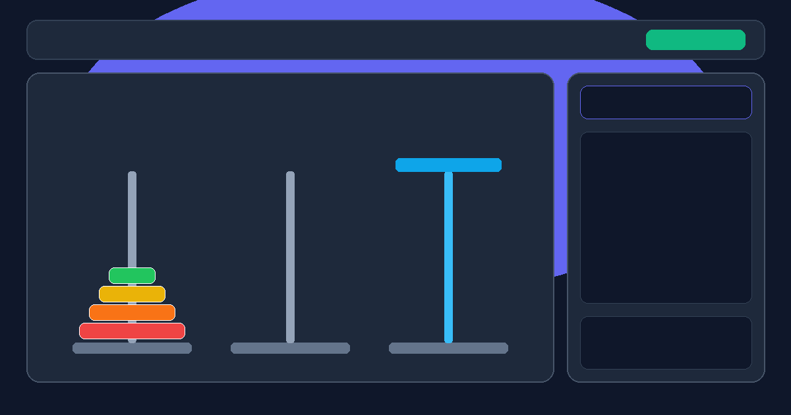

# Towers of Hanoi — Real-Time Multiplayer

> A real-time multiplayer implementation of the classic Towers of Hanoi puzzle featuring synchronized room lobbies, live move validation, and competitive race/leaderboard mechanics.

[](https://adithya181206.github.io/toh/)
[](https://developer.mozilla.org/en-US/docs/Web/JavaScript)
[](https://developer.mozilla.org/en-US/docs/Web/CSS)
[](https://firebase.google.com/)
[](manifest.json)
[](LICENSE)

---

## Visual Preview



---

## Executive Summary & Key Features

**Towers of Hanoi Multiplayer** transforms the timeless mathematical recursive puzzle into a high-stakes, low-latency online speed race. Built with pure modern web technologies and real-time state synchronization, players compete head-to-head in private or shared match lobbies to solve the optimal disk-stacking sequence with minimal moves and elapsed time.

* **Real-Time Multiplayer Rooms**: Create or join match lobbies supporting 2 to 10 simultaneous players via unique 6-character room codes or instant one-click invite URLs (`?room=CODE`). Integrated presence management auto-cleans disconnecting players using Firebase `onDisconnect()`.
* **Authoritative Strict Rule Validation**: Enforces classic mathematical Hanoi constraints locally with constant-time $O(1)$ stack-top verification. Illegal transfers (placing a larger disk on a smaller one) are strictly blocked with immediate visual shake and highlight alerts.
* **Live Opponent Progress & Telemetry**: Dynamic finish order synchronization via Firebase Realtime Database. Tracks move counts, elapsed millisecond timers, and benchmarks against theoretical minimum moves ($2^n - 1$).
* **Configurable Difficulty & Controls**: Dynamic disk selector allowing 3 to 8 disks ($2^3 - 1 = 7$ moves up to $2^8 - 1 = 255$ moves). Host difficulty automatically propagates to all joined clients. Features two-tap click-to-move tower interactions with responsive CSS disk proportions and unique glyph identifiers.
* **In-Game Chat & Live Reactions**: Integrated room chat with real-time text broadcast and interactive floating reaction emojis (🚀, 😂, 😭, 🎉, 🔥, 👀) synchronized across all connected viewports.
* **Progressive Web App (PWA) Support**: Native standalone web application capability defined through `manifest.json`, optimized for desktop, tablet, and mobile browsers with zero external build dependencies.

---

## System Architecture & Multiplayer Sync Flow

The architecture leverages client-side deterministic puzzle rendering paired with Firebase Realtime Database as the real-time synchronization backend and WebSocket transport broker.

### Architecture Diagram

```
+-----------------------------------------------------------------------------------+
|                                 CLIENT VIEWPORTS                                  |
|                                                                                   |
|  +---------------------------+                     +---------------------------+  |
|  |     Player 1 (Host)       |                     |     Player N (Joiner)     |  |
|  |  +---------------------+  |                     |  +---------------------+  |  |
|  |  | UI Renderer / DOM   |  |                     |  | UI Renderer / DOM   |  |  |
|  |  +----------+----------+  |                     |  +----------+----------+  |  |
|  |             |             |                     |             |             |  |
|  |  +----------v----------+  |                     |  +----------v----------+  |  |
|  |  | Local LIFO Peg      |  |                     |  | Local LIFO Peg      |  |  |
|  |  | State (O(1) Rules)  |  |                     |  | State (O(1) Rules)  |  |  |
|  |  +----------+----------+  |                     |  +----------+----------+  |  |
|  |             |             |                     |             |             |  |
|  |  +----------v----------+  |                     |  +----------v----------+  |  |
|  |  | Firebase Client SDK |  |                     |  | Firebase Client SDK |  |  |
|  +-------------+-------------+                     +-------------+-------------+  |
+----------------|-------------------------------------------------|----------------+
                 | (Bidirectional WebSocket Stream - WSS)           |
                 +-----------------------+-------------------------+
                                         |
                                         v
+-----------------------------------------------------------------------------------+
|                     FIREBASE REALTIME DATABASE (State Broker)                     |
|                                                                                   |
|   /rooms/{roomId}                                                                 |
|   ├── status: "waiting" | "playing"       (Synchronized Match Gate)               |
|   ├── maxPlayers: 2 .. 10                 (Room Capacity Arbiter)                 |
|   ├── totalDisks: 3 .. 8                  (Host Difficulty Config)                |
|   ├── players/                            (Presence & Heartbeat Roster)           |
|   │   └── {playerId}: { id, name }                                                |
|   ├── finishOrder/                        (Append-Only Race Leaderboard)          |
|   │   └── {pushId}: { id, name, moves, time }                                     |
|   ├── chat/                               (Real-Time Text Broadcast)              |
|   │   └── {pushId}: { senderId, name, msg }                                       |
|   └── emojis/                             (Ephemeral Reaction Bursts)             |
|       └── {pushId}: { emoji, id }                                                 |
+-----------------------------------------------------------------------------------+
```

### Game & Move Synchronization Sequence

```
Host (Player 1)              Firebase RTDB                    Joiner (Player 2)
      |                            |                                  |
      |-- Create Room (Code) ----->|                                  |
      |   [status: "waiting"]      |                                  |
      |   [totalDisks: N]          |                                  |
      |                            |<-- Join via Code / URL ----------|
      |                            |    [Register player profile]     |
      |<-- Broadcast Lobby Update -|-- Broadcast Lobby Update ------->|
      |    (2/2 Joined)            |   (Difficulty synchronized)      |
      |                            |                                  |
      |-- Host clicks "Start" ---->|                                  |
      |   [status: "playing"]      |                                  |
      |<-- Trigger Start Race -----|-- Trigger Start Race ----------->|
      |    [startTime = now]       |   [startTime = now]              |
      |                            |                                  |
      |================ COMPETITIVE RACE PHASE =======================|
      |  (Independent O(1) Local Stack Moves, Disks & Timer Update)   |
      |                                                               |
      |-- (Optional) Live Chat / Emoji Broadcast -------------------->|
      |                                                               |
      |-- Solves Puzzle (Peg 2) -->|                                  |
      |   [Push finishOrder]       |                                  |
      |<-- Broadcast 1st Place ----|-- Broadcast Winner Alert ------->|
      |                            |                                  |
      |                            |-- Finishes Puzzle -------------->|
      |                            |   [Push finishOrder]             |
      |<-- Final Scoreboard Sync --|-- Final Scoreboard Sync -------->|
      |                                                               |
      |-- Rematch: Host resets --->|-- Rematch: Round resets -------->|
      |   [status: "waiting"]      |   [status: "waiting"]            |
```

---

## Tech Stack

| Layer | Technology / Library | Purpose & Implementation |
| :--- | :--- | :--- |
| **Frontend UI** | HTML5 (Semantic5) | Accessible board layout, responsive panels, and modal ranking overlays |
| **Styling & Effects** | CSS3 & Modern Glassmorphism | Custom CSS properties, dynamic gradient disk width scaling, fluid layout |
| **Core Logic** | Vanilla JavaScript (ES6+) | LIFO stack data structures, event listeners, move counters, and timers |
| **Networking & Transport** | Firebase Realtime Database SDK (v9 compat) | Low-latency WebSockets, presence detection (`.info/connected`, `onDisconnect`) |
| **PWA Infrastructure** | Web App Manifest (`manifest.json`) | Standalone display mode, responsive viewport metadata, mobile-app feel |
| **Typography & Assets** | Google Fonts (Outfit) & SVG Icons | Modern typography, high-DPI custom vector icons |
| **Deployment / CI** | GitHub Pages / Static Web Server | Zero-build serverless static asset delivery |

---

## Project Structure

```
toh/
├── assets/
│   └── preview.png          # High-resolution UI preview & banner graphic
├── .env.example             # Firebase configuration template & environment variables
├── .git/                    # Git version control metadata
├── index.html               # Main application entry point, game layout & modals
├── LICENSE                  # MIT open-source license
├── manifest.json            # Progressive Web App manifest configuration
├── README.md                # Comprehensive project documentation & architecture guide
├── script.js                # Core game engine, validation logic & Firebase sync handlers
└── style.css                # Glassmorphic UI stylesheet, animations & responsive media queries
```

---

## Quick Start & Local Setup

### Prerequisites

* Any modern web browser (Google Chrome, Mozilla Firefox, Microsoft Edge, Safari) with JavaScript enabled.
* (Optional) Node.js ($\ge$ 18) or Python ($\ge$ 3.9) to serve static files locally.

---

### Step 1: Clone the Repository

```bash
git clone https://github.com/adithya181206/toh.git
cd toh
```

---

### Step 2: Environment & Firebase Configuration

The game works out-of-the-box using standard Firebase Realtime Database parameters configured in `script.js`. If you wish to connect your own Firebase instance:

1. Copy `.env.example` to review the required configuration schema:
   ```bash
   cp .env.example .env
   ```
2. Open `script.js` and update the `firebaseConfig` block:
   ```javascript
   const firebaseConfig = {
       apiKey: "YOUR_API_KEY",
       authDomain: "YOUR_PROJECT_ID.firebaseapp.com",
       databaseURL: "https://YOUR_PROJECT_ID-default-rtdb.firebaseio.com",
       projectId: "YOUR_PROJECT_ID",
       storageBucket: "YOUR_PROJECT_ID.firebasestorage.app",
       messagingSenderId: "YOUR_MESSAGING_SENDER_ID",
       appId: "YOUR_APP_ID"
   };
   ```
3. Set your Firebase Realtime Database security rules to allow room read/write:
   ```json
   {
     "rules": {
       "rooms": {
         "$room_id": {
           ".read": true,
           ".write": true
         }
       }
     }
   }
   ```

---

### Step 3: Run Locally & Test Multiplayer

Run a lightweight static local server:

**Using Python:**
```bash
python -m http.server 8000
```

**Using Node.js (`npx`):**
```bash
npx serve .
```

**Test a live 2-player match locally:**
1. Open `http://localhost:8000` in your main browser window.
2. Select **Multiplayer (Online)** $\rightarrow$ **Create Room**, enter your name, pick the disk difficulty (e.g., 3 Disks), and click **Create Room**.
3. Copy the generated 6-character room code (or click **Copy Link**).
4. Open an **Incognito / Private Window** (or a second browser) and navigate to `http://localhost:8000`.
5. Select **Multiplayer (Online)** $\rightarrow$ **Join Room**, enter a second player name and the room code, then click **Join Room**.
6. Once both players join, click **▶ Start Race!** to initiate the synchronized match countdown!

---

## Network Events & Game State Protocol

All multiplayer communication runs via Firebase Realtime Database JSON nodes:

| Path / Event Key | Direction | Payload & Purpose |
| :--- | :--- | :--- |
| `rooms/{roomId}/status` | Client $\leftrightarrow$ Firebase RTDB | `string ("waiting" \| "playing")` — Synchronizes race start gate and resets rounds on replay. |
| `rooms/{roomId}/maxPlayers` | Host $\rightarrow$ Firebase $\rightarrow$ Clients | `integer (2..10)` — Establishes maximum room capacity; joiners sync lobby boundary. |
| `rooms/{roomId}/totalDisks` | Host $\rightarrow$ Firebase $\rightarrow$ Clients | `integer (3..8)` — Synchronizes puzzle difficulty and disk stacks across all competitors. |
| `rooms/{roomId}/players/{playerId}` | Client $\rightarrow$ Firebase $\rightarrow$ Clients | `{ id: string, name: string }` — Maintains active lobby presence; cleared automatically on disconnect. |
| `rooms/{roomId}/finishOrder` | Client $\rightarrow$ Firebase $\rightarrow$ Clients | `{ id: string, name: string, moves: number, time: number }` — Appends completed player stats to calculate real-time podium ranks. |
| `rooms/{roomId}/chat` | Client $\rightarrow$ Firebase $\rightarrow$ Clients | `{ senderId: string, name: string, msg: string }` — Broadcasts real-time in-game text messages. |
| `rooms/{roomId}/emojis` | Client $\rightarrow$ Firebase $\rightarrow$ Clients | `{ emoji: string, id: string }` — Ephemeral floating emoji reaction trigger across active screens. |
| `.info/connected` | Firebase SDK $\rightarrow$ Client | `boolean` — Local network health monitoring driving the real-time connection badge. |

---

## Algorithmic Complexity & Game Logic Notes

### Mathematical Principles
The Towers of Hanoi puzzle with $n$ disks requires a theoretical minimum number of moves governed by:

$$M(n) = 2^n - 1$$

| Disks ($n$) | Minimum Moves ($2^n - 1$) | Time Benchmark (at 1 move/sec) |
| :---: | :---: | :---: |
| 3 | 7 | ~7 seconds |
| 4 | 15 | ~15 seconds |
| 5 | 31 | ~31 seconds |
| 6 | 63 | ~1 minute |
| 7 | 127 | ~2.1 minutes |
| 8 | 255 | ~4.2 minutes |

### Data Structures & Complexity
* **Peg Representation**: Modeled as 3 discrete Last-In-First-Out (LIFO) stacks: `towers = [[], [], []]`.
* **Move Legality Verification**: When moving a disk from peg $i$ to peg $j$:
  $$d_{\text{source}} = \text{towers}[i][-1], \quad d_{\text{target}} = \text{towers}[j][-1]$$
  Valid move condition: $\text{towers}[j]\text{.length} == 0 \lor d_{\text{target}} > d_{\text{source}}$.
* **Time Complexity**:
  * Validation: $\mathcal{O}(1)$ constant-time top-element inspection.
  * Move Execution: $\mathcal{O}(1)$ push/pop stack operations.
  * Win Condition Check: $\mathcal{O}(1)$ check: `towers[2].length === totalDisks`.
* **Space Complexity**: $\mathcal{O}(n)$ linear memory consumption where $n$ is total disks.

---

## Future Enhancements

| Enhancement | Description | Priority |
| :--- | :--- | :---: |
| **Live Opponent Ghost Board** | Real-time mini-board preview rendering opponent disk moves as they happen. | High |
| **Algorithmic AI Solver Bot** | Built-in recursive and iterative solver bots with adjustable speed (Easy, Medium, Grandmaster). | High |
| **Global Persistent Leaderboard** | Firebase Authentication integration with persistent Elo ratings and global high-score boards. | Medium |
| **Interactive Move Replay** | Post-match step-by-step playback with branch exploration to analyze suboptimal moves. | Medium |
| **Synthesized Audio Effects** | Web Audio API sound effects for disk pickup, disk drop, error buzzer, and victory fanfares. | Low |

---

## Author & License

Developed and engineered by **Etikala Adithya**:
* **Degree**: B.Tech in Computer Science and Engineering
* **Institution**: B V Raju Institute of Technology (BVRIT)
* **GitHub**: [@adithya181206](https://github.com/adithya181206)
* **Repository**: [adithya181206/toh](https://github.com/adithya181206/toh)

This project is licensed under the terms of the [MIT License](LICENSE).

